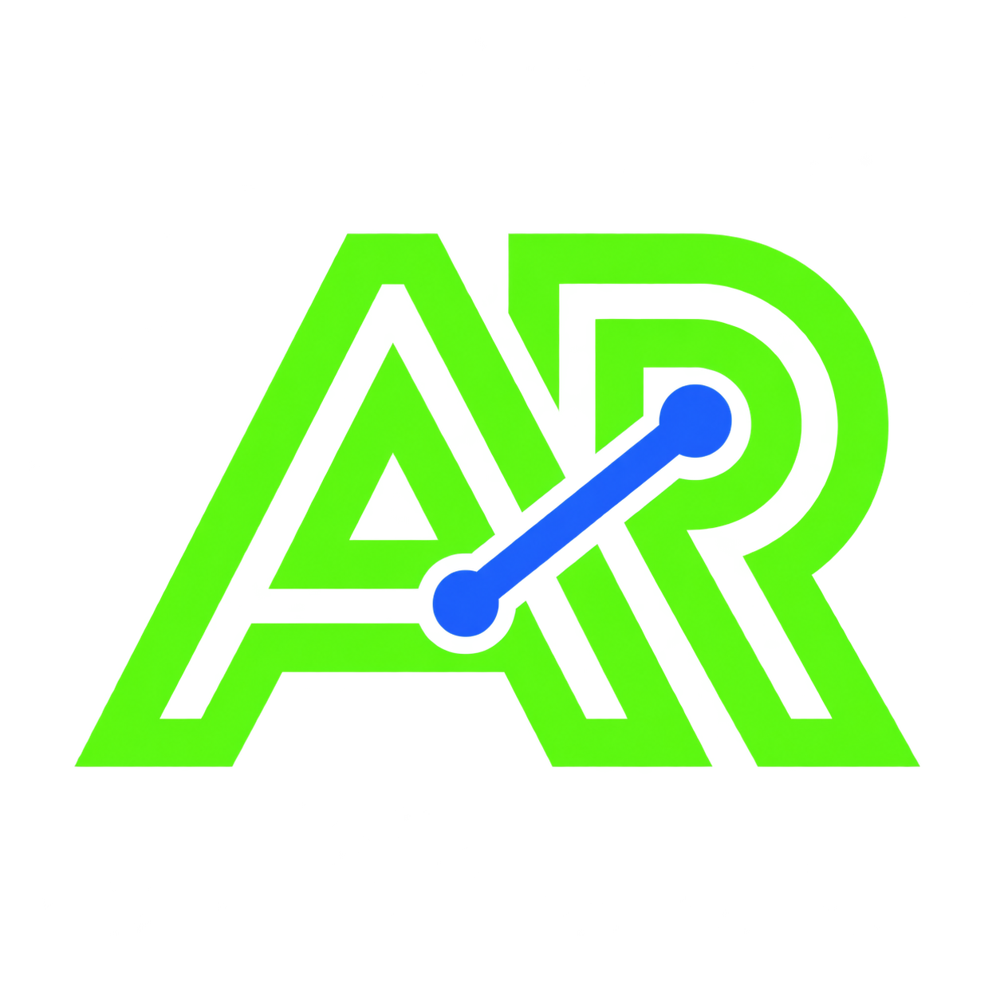
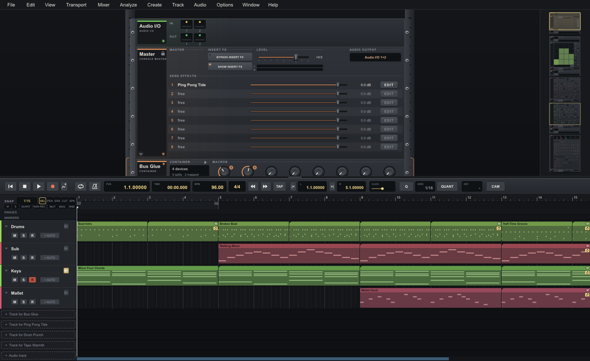
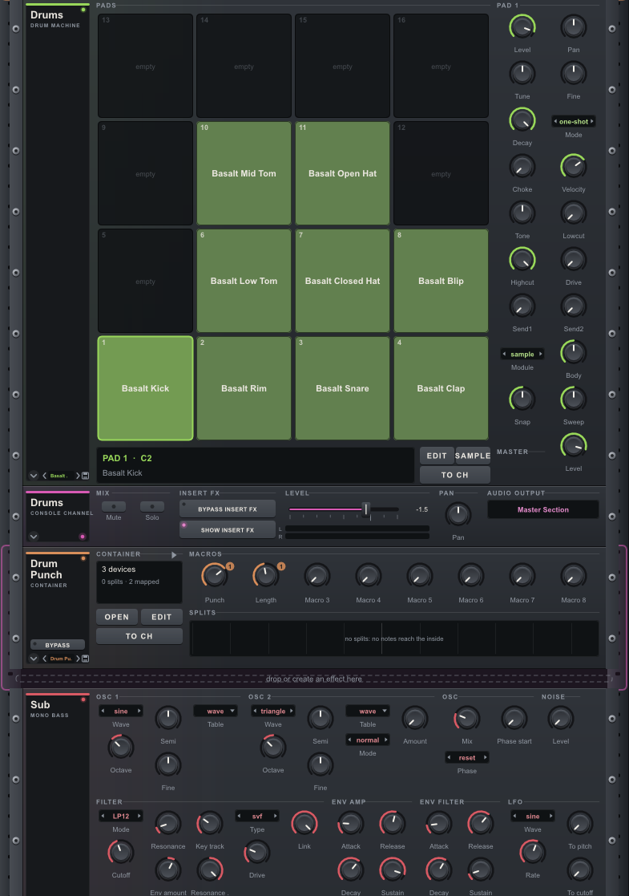
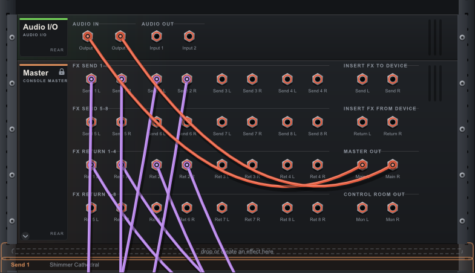
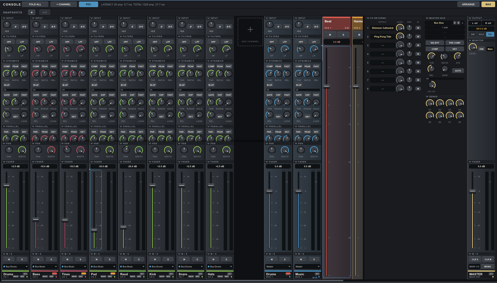

# Atomik Rack

  

  
   
  <a href="https://www.youtube.com/playlist?list=PLBRQGwLelowM"><b>▶ Watch the video series</b></a>

  
  
  

**A free, open-source, rack-based digital audio workstation written in Rust.** Put virtual
devices in a rack, patch them together with **audio**, **CV** and **note** cables, then sequence,
record, mix and master the result with an arrangement, a console and a master section, on
Windows, Linux and macOS.

  <b><a href="https://atomikcircus.com/atomik-rack/download/">Download</a></b> ·
  <a href="https://atomikcircus.com/atomik-rack/">Website</a> ·
  <a href="https://atomikcircus.com/atomik-rack/tutorials/">Step-by-step tutorials</a> ·
  <a href="https://www.youtube.com/playlist?list=PLBRQGwLelowM">Videos</a> ·
  <a href="https://buymeacoffee.com/atomik.factory">☕ Buy me a coffee</a>

The project is original work, released under the GPL-3.0-or-later. It is pre-1.0: file formats,
APIs and behaviour will change (see [CHANGELOG.md](CHANGELOG.md)).

## See it

| The rack | The back of the rack |
|---|---|
|  |  |

The screenshots show the factory songs that ship with the program. The interface is drawn
procedurally (vector graphics, system fonts).

## Highlights

- **Make sounds.** Poly, FM, wavetable, grain and plucked-string synths, a drawbar organ, a
  semi-modular synth, a multi-zone sampler, a 16-pad drum machine and a loop slicer.
- **Patch anything.** Front and back views with audio, CV and note cables, containers with macros
  and note splits, and players (step sequencer, arpeggiator, Chord Wheel, Key & Chord, drum
  generator) that stack on any instrument. Edit freely while the audio plays.
- **Arrange and record.** Note, audio and automation clips, a piano roll, audio recording, comping,
  time-stretch, a clip launcher, chord and key lanes, video sync, and MIDI and webcam control.
- **Mix and master.** A console with full channel strips, sends, buses, VCAs and snapshots, a
  master chain with EQ, dynamics, saturation, loudness and tonal-balance meters, and exports with
  loudness targets for streaming, podcasts, video and stems.
- **Learn and practise.** Guitar tab import, editing and printing, a fretboard, listen-and-grade
  and a chord trainer, a guided tour and a Help Mode that explains every control.
- **Plugins, safely.** CLAP and VST3 instruments and effects, each in its own process, so a plugin
  crash cannot take the program down.
- **Private by design.** Nothing about you or your computer is ever sent (see [Privacy](#privacy)).

<b>The full feature list</b>

- **The rack.** A device rack with front and back views, audio, CV and note cables, hot editing while audio plays (adding, removing and cabling devices never resets the others), undo and redo, a cable graph that is checked when you connect (types must match, no cycles).
- **Console.** A channel strip per instrument (gain, filters, dynamics, EQ, insert chain, 8 sends, pan, fader), solo and mute, meters and automatic delay compensation across the whole graph.
- **Master section.** A locked master with 8 send buses and FX returns, a bus compressor with a sidechain key, a control-room output and the Audio I/O device with per-socket meters.
- **Sampler, drum machine and loop slicer.** A multi-zone sampler with loops, crossfades and reverse; a 16-pad drum machine with choke groups, velocity layers and individual outputs; a loop slicer with transient detection and "slices to track".
- **Grain sampler.** One sample (or a built-in vowel pad) played as a cloud of grains: density, size, three windows, a position with scan and spray, per-grain pitch scatter, reversed grains, stereo spread and a grain cap with deterministic stealing, with a filter, LFO, mod envelope, mod wheel and CVs, a waveform panel that shows the live grains, and five factory sounds.
- **FM synth.** Four sine operators with twelve routings (an algorithm diagram on the panel), ratio or fixed frequency, per-operator envelopes with a delay, velocity and key scaling, a damped feedback path, a pitch envelope, an LFO, the mod wheel on the modulation index, poly, mono and legato with glide, a limiter against aliasing on high keys, and six factory sounds (electric piano, bell, bass, brass, pad).
- **Wavetable synth.** Two wavetable oscillators over twelve factory tables (saw to square, pulse width, vowels, hard sync, FM and more, all generated in code and band-limited so they do not alias), a frame position you can sweep with the mod envelope, the LFO or a CV, up to seven unison copies with detune and stereo spread, a sub and noise, a filter, two envelopes and an LFO.
- **Effects.** Reverb, compressor (sidechain, look-ahead), 6-band EQ, oversampled distortion, a guitar amp (preamp, tone stack, power amp, a synthesised cabinet, chorus, delay and reverb, with five setups), chorus/flanger/phaser, a mastering suite (multiband, width, true-peak limiter, BS.1770 loudness meter), and two analysers that pass the audio through untouched: a spectrum (FFT up to 65536 points or one-third-octave bands, a spectrogram, smoothing, K-weighting, peak hold and a stored reference curve) and a phase meter (goniometer, correlation, balance, width, peak and RMS bars, momentary, short-term and integrated LUFS, and a loudness history graph with the range and a target line).
- **The Character effect.** A stereo insert with 16 presets in a 4 x 4 matrix and a Transform macro that morphs each preset, built from an original set of DSP stages.
- **Players.** A step sequencer and an arpeggiator that send notes and CV to any device, synchronised to the transport, a note filter that transposes and filters notes, a Key & Chord that locks notes to a scale and plays chords, a Chord Wheel that plays a progression of eight chords in time (made by hand on a circle-of-fifths wheel or by a mood-based generator, with sixteen factory progressions), a Note Repeater that echoes notes and a Note Delay that moves them in time (swing, humanize); players stack above an instrument and play through it for its track.
- **Container device.** A device that holds another rack: its own devices and cables, 8 macro knobs and key/velocity note splits. Containers are flattened for the engine, so they cost nothing special at run time.
- **Plugin hosting.** CLAP and VST3 instruments and effects are rack devices like any built-in one (cabled, automated, macro-mapped, saved and bounced). Each instance runs in its own process, so a plugin crash cannot take the app down; scanning runs out of process. VST2 is not supported.
- **Arrangement and audio.** Note, automation and audio clips, with several note lanes per track; a piano roll and step/slice/sample editors; import of WAV, AIFF, FLAC, MP3 and OGG; audio recording with latency compensation, an input gain with a level meter and a clip-safe limiter; large files stream from disk.
- **File browser.** A docked panel (`F9`) to browse folders, search by name, `#tag`, `kind:`, `author:` or favourites, keep named favourite lists, preview audio files with one click and drag them onto the arrangement, sample editor or a sampler; tags, authors, categories and favourites are saved in `library.json` next to the settings.
- **Library.** The file browser's Library sections list the built-in devices and the patches, containers, clips and projects in your library folder. **Save to Library** (device and clip context menus) writes the selected devices, a container or a note clip there, with their samples; double click or drag an item onto the rack (devices) or a note lane (clips) to load it as one undo step, and a project opens after the question about unsaved changes. Items are plain project texts (`.atomikpatch`, `.atomikcontainer`) and a small clip file (`.atomikclip`).
- **Languages.** The interface is in English and in French: Settings > Video > Language offers System (the language of your computer, English when the program has no text in it), English and Français, and a change applies at once. The menus, the commands, the settings, the dialogs, the status messages and the tooltips are translated; the manual, the Help Mode texts and the parameter names of most device panels are still English, and a text with no translation shows in English. A language is one text file (see [docs/EXTENDING.md](docs/EXTENDING.md#8-adding-a-language)).
- **Workflow and keymap.** A data-driven keymap with a standard profile and a legacy profile, remappable in Settings (see [docs/KEYBOARD.md](docs/KEYBOARD.md)), tools (select, pencil, eraser, razor), a clipboard for clips, notes, devices and tracks, context menus, and a creation chain that wires new instruments and effects automatically.
- **Video.** A song can hold one film, decoded by the FFmpeg you install (on your `PATH`, or the folder set in Settings > Video; nothing is bundled, and without FFmpeg video is off and nothing else changes). File > Video imports a film (it is linked, never copied), shows it at the song position in the View > Video window, and in a row of thumbnails above the tracks where you drag it to move it or drag an end to trim it, frame-snapped, each edit one undo step. Import Video Audio takes the film's own sound out through FFmpeg and puts it on a new track named after the film, lined up with the first frame to the sample (a pop-up asks which track when the film has several); with Keep Audio with Video on, moving or trimming the film moves and trims that clip in the same undo step. File > Export > Film with Mix writes a new film: the song's mix over the film's picture, for the part of the song the film covers (or the whole song, with black pictures around the film). The picture is copied without re-encoding when the cut is at the film's start, or re-encoded to H.264 for exact cuts (a copy cuts at keyframes, so a cut that is not at the start can begin a little early: the dialog says so); the mix goes in as AAC in an MP4 file or as PCM in a MOV file, and the film's own sound can stay as a second track. It needs FFmpeg, runs on a worker with progress and cancel, and leaves no partial file.
- **Webcam control.** Turn the last knob you clicked with your hand: click a knob, pinch your thumb and index finger in front of the camera and twist your wrist. The camera is off until you turn it on (the CAM button of the transport bar), the first time after a question that says what is downloaded (two hand models, 7.8 MB, once) and from where, and it shows a small preview with the hand on it. A pinch and twist is one undo step, like a mapped MIDI controller. Pinch with both hands to sweep the last two knobs you clicked together, and a fist, a thumbs up, a point, a peace sign or a swipe can run any command (none by default; Settings > Camera has a Suggested button), for all your projects or one. Camera pictures stay in memory: they are never saved, logged or sent anywhere, and the camera is off when you quit. See [docs/README.md](docs/README.md#webcam-control).
- **Offline bounce.** `atomik-render` renders patches and projects to WAV, bit-identical for any block size and worker count.
- **Export.** The song, the loop or the selected range goes to WAV, AIFF or FLAC with dither and a loudness report, or to MP3, AAC (`.m4a`) and Opus through the FFmpeg you install (on your `PATH`, or the folder set in Settings > Video; without it those three are greyed and nothing else changes). Compressed files carry the song's title and author as tags; leave about 1 dB of true-peak headroom, since lossy encoding can raise the peaks. Stems are WAV, AIFF or FLAC. The file dialog proposes the extension of the format you used last, and an export whose format gives the name of a file that exists asks before replacing it. **Export presets** do it for a purpose: the Preset row of the export panel and File > Export for offer Streaming (a 24-bit WAV and an MP3 at 320 kbps, both at -14 LUFS with the true peaks under -1 dBTP), Podcast (a mono MP3 at 128 kbps, -16 LUFS), Video (AAC at 256 kbps and 48 kHz, -14 LUFS; with a film in the song, the film with that mix), Stems for mixing (a 24-bit WAV per strip, no loudness change, no dither) and Club (a 24-bit WAV with -9 LUFS as a guide only: nothing is changed, and the report warns when the peaks clip). Choosing one fills the panel's fields, which you can still change (the name then shows "(changed)"); Save Preset keeps the panel's fields under a name of your own, in `export_presets.json` next to `settings.json`. A loudness target turns the whole mix up or down to the target, and when that would push the peaks past the ceiling a true-peak limiter holds them there; the toast says what the level was before, what was done and any limiting. The presets that write MP3, AAC or Opus say "Needs FFmpeg" and are greyed without it.
- **Projects.** A project with audio is a bundle folder (`name/name.atomik` plus `Audio/`, files named by content hash); a project without audio is a single `.atomik` file. Saves are atomic.
- **More instruments.** Plucked Strings (a physical-model string with guitar, bass, ukulele, banjo, mandolin and more, honouring palm mutes, harmonics, dead notes and bends), a drawbar organ that plays straight into a rotary speaker, Mono Bass, Dual Layer and a Semi-Modular synth built from the CV devices.
- **Mixing and mastering tools.** A 7-band EQ with mid/side and an analyser, a Dynamic EQ, Saturation, a Clipper, a Stereo Tool, a Gain tool, a Loudness Meter with platform targets, a Tonal Balance meter that learns targets from reference tracks, Headphone Correction from your own measurement files, a spectrum with an L/R overlay, a space reverb, a convolution reverb and a vocoder; mixer snapshots, VCA groups and a masking map.
- **Guitar tab.** Import Guitar Pro (`.gp3` to `.gp5`, `.gpx`, `.gp`), MusicXML, ASCII tab and chord sheets; edit in a Tab Editor for 24 fretted instruments and tunings; print to PDF; practise with loop, slow-down, count-in, a fretboard view, listen-and-grade and a Chord Trainer (see [docs/TAB.md](docs/TAB.md)).

## Install

Release builds are attached to each [GitHub release](https://github.com/atomikfactory/atomik-rack/releases), each with a `SHA256SUMS` file to check them against:

- **Windows:** `atomik-rack-<version>-windows-x86_64-setup.exe` (installer) or `atomik-rack-<version>-windows-x86_64.zip`.
- **macOS (Apple Silicon and Intel):** `atomik-rack-<version>-macos-universal.dmg` or `atomik-rack-<version>-macos-universal.zip`.
- **Linux (x86-64):** `atomik-rack-<version>-x86_64.AppImage` (any distribution), `atomik-rack_<version>_amd64.deb` for Debian and Ubuntu, or `atomik-rack-<version>-linux-x86_64.tar.gz`.

**System requirements:** a graphics driver with DirectX 12, Vulkan or Metal (the interface is drawn on the graphics card; there is no software-rendering mode).

A [nightly build](https://github.com/atomikfactory/atomik-rack/releases/tag/nightly) of `main` is published every day that it changes, under the same names with `nightly-<date>-<commit>` as the version. It is a pre-release: expect rough edges.

Builds are code-signed (Windows) and notarised (macOS) only when the project's signing certificates are configured, and the release notes say whether they were. They are not signed yet, so each system warns the first time; the steps below work whether or not a build is signed.

- **Windows.** Run the installer (it asks for administrator rights to install for everyone, and offers to install just for you), or unzip the archive and run `atomik.exe`. If SmartScreen says "Windows protected your PC", choose **More info**, then **Run anyway**.
- **macOS.** Open the disk image and drag `Atomik Rack.app` to Applications (or unzip the archive). A build that is not notarised is only ad-hoc signed: right-click the app, choose **Open**, then **Open** again. Or remove the quarantine flag once: `xattr -dr com.apple.quarantine "/Applications/Atomik Rack.app"`.
- **Linux.** Install the package with `sudo apt-get install ./atomik-rack_<version>_amd64.deb` (it pulls in ALSA and fontconfig and puts `atomik` on your path), or extract the archive and run `./atomik`. The **AppImage** needs no installation: `chmod +x atomik-rack-<version>-x86_64.AppImage`, then run it (it takes ALSA, fontconfig and the graphics driver from your system, like the archive, and needs a C library at least as new as Ubuntu's of the build). The archive needs ALSA (`libasound2`), fontconfig (`libfontconfig1`) and a working Vulkan driver; on Debian/Ubuntu: `sudo apt-get install libasound2 libfontconfig1`.

## First steps

The first time Atomik Rack starts, a short setup gets sound working: pick the audio device and the
buffer size, press **Test** to hear a soft chord, choose an input if you record and tick your MIDI
keyboard. Options > Audio and MIDI Setup... opens it again at any time.

The **start screen** offers a new song, templates, your recent songs and the example songs that ship
with the program. **Make your first song** (or Help > Guided Tour) walks you through seven steps:
add an instrument, play or draw notes, loop them, add drums, mix, save and export.

Three keys to remember:

- **Ctrl+Shift+K** (Cmd+Shift+K on macOS) opens the Command Palette: type a few letters of any
  command and press Enter.
- **Shift+F1** turns on Help Mode: point at any control to read what it does. **F1** lists the
  keyboard shortcuts ([docs/KEYBOARD.md](docs/KEYBOARD.md)).
- **Edit > Undo History** lists every edit: click a row to go back to the song as it was then.

The [step-by-step tutorials](https://atomikcircus.com/atomik-rack/tutorials/) and the [video series](https://www.youtube.com/playlist?list=PLBRQGwLelowM) show the rest.

## Status

- **Windows (x86-64) and Ubuntu (x86-64, 26.04) are the main platforms.** The application is
  developed and hand-tested on both, including ASIO audio on Windows. Other Linux distributions and
  audio setups have not been checked yet: please report rough edges.
- **macOS is tested only on GitHub Actions.** It is built, linted and tested in CI, but has not been
  run on a Mac by hand yet. Reports from Mac users are especially welcome.
- Nothing is stable yet. See [ROADMAP.md](ROADMAP.md) for what is planned and what is missing.

## Privacy

Atomik Rack sends nothing about you or your computer anywhere. The program makes only two kinds of
network request, and both are optional:

- **The update check**, off until you answer Yes to "Check for new versions once a day?". It asks
  `api.github.com` for this project's releases, with no identifier and no cookie, and only
  announces a newer version with a link: nothing is downloaded or installed.
- **The webcam hand models**, a one-time download that starts only when you press Download in a
  dialog that says what, from where and how big; each file is checked against a checksum.

The details

The update check sends the address and the name `atomik-rack` with its version as the User-Agent,
and nothing else. A Yes makes one request a day at the start, and Help > Check for Updates makes
one when you choose it; Settings > Video & updates changes the answer at any time. The webcam
downloads use one fixed HTTPS address per file and send nothing about you or your computer. The
camera picture is only used while the camera is on, only in memory, and never saved, logged or
sent.

## Building from source and developing

[docs/BUILDING.md](docs/BUILDING.md) covers building on Windows, macOS and Linux (and the optional
ASIO build), running the example projects, rendering patches and projects with `atomik-render`,
the four [hard invariants](docs/BUILDING.md#hard-invariants), the crate map and the checks CI runs.

## Documentation

- [docs/README.md](docs/README.md): the user guide and the index of the documentation.
- [docs/BUILDING.md](docs/BUILDING.md): building, running, rendering and checking a change.
- [docs/ARCHITECTURE.md](docs/ARCHITECTURE.md): crates, data flow, threads and how each hard
  invariant is enforced.
- [docs/DEVICES.md](docs/DEVICES.md): sockets and parameters of every device.
- [docs/EXTENDING.md](docs/EXTENDING.md): how to write a new device.
- [docs/TESTING.md](docs/TESTING.md): gates, the allocation guard, determinism tests, goldens and
  manual tests.
- [docs/KEYBOARD.md](docs/KEYBOARD.md): the keyboard reference (generated).
- [docs/TAB.md](docs/TAB.md): the guitar tab user guide (import, edit, print, practice).
- [ROADMAP.md](ROADMAP.md) and [CHANGELOG.md](CHANGELOG.md).

## Contributing

Contributions are welcome. Read [CONTRIBUTING.md](CONTRIBUTING.md) first: it covers the original-work policy, the DCO sign-off (`git commit -s`), the test-driven workflow and the real-time safety rules. All participants follow the [Code of Conduct](CODE_OF_CONDUCT.md). Report security issues privately as described in [SECURITY.md](SECURITY.md). For questions and help, see [SUPPORT.md](SUPPORT.md).

## Licence

Copyright © Atomik Rack contributors.

Atomik Rack is free software: you can redistribute it and/or modify it under the terms of the GNU General Public License as published by the Free Software Foundation, either version 3 of the License, or (at your option) any later version (`GPL-3.0-or-later`). It is distributed in the hope that it will be useful, but WITHOUT ANY WARRANTY. See [LICENSE](LICENSE) for the full text.

No fonts, images or audio from third parties are bundled: the interface uses system fonts and procedural graphics, and the example audio is generated by the project's own code (see [examples/README.md](examples/README.md)).

## Trademark notice

Atomik Rack is an independent project and is not affiliated with, endorsed by or sponsored by any other company or product.

VST is a trademark of Steinberg Media Technologies GmbH, registered in Europe and other countries. ASIO is a trademark of Steinberg Media Technologies GmbH. CLAP is an open plugin standard. Atomik Rack hosts plugins in the CLAP and VST3 formats; the names VST3, ASIO and CLAP are used only to say which formats and drivers are supported, and the project uses no VST or ASIO logo. Windows, macOS, Linux and all other product, plugin and company names that appear in the application or on this page belong to their respective owners; plugin and vendor names shown in the browser come from the plugin files themselves.
